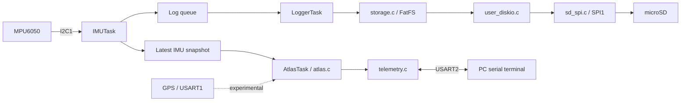

# ATLAS Mission Computer

**STM32F401RE · FreeRTOS · MPU6050 · SPI microSD · UART telemetry**

ATLAS is a laboratory embedded-systems prototype for acquiring inertial measurements, estimating roll/pitch, sending serial telemetry, and logging timestamped measurements to microSD. It is intended as an educational, modular firmware project, **not flight-qualified or safety-critical software**.

**Start here:** [Quick start](#quick-start) · [Hardware](#hardware-and-wiring) · [Architecture](#architecture) · [Testing](#smoke-test-checklist) · [Contributing](#contributing) · [Known issues](#known-issues-and-limitations)

## Project status

The firmware identifies itself as **v0.8**. The repository includes an STM32CubeIDE project and the MCU firmware. GPS integration is experimental, not operational.

| Area | Current state | Notes |
| --- | --- | --- |
| STM32F401RE + CubeIDE | Working in prior bench tests | Clean builds reported during development |
| MPU6050 / I2C1 | Working in prior bench tests | Accelerometer-based roll and pitch; no yaw |
| USART2 telemetry + commands | Working in prior bench tests | 115200 baud, ASCII; `PING` and `CALIBRATE` |
| FreeRTOS tasks | Implemented | AtlasTask, IMUTask, LoggerTask |
| SPI microSD / FatFS | Working in prior bench tests | Custom `sd_spi` driver; persistent CSV logger |
| Queue monitoring | Implemented | Logger-ready gating and drop count |
| GPS / USART1 | **Unverified** | GY-GPS6MU2 produced repeated `0x00` during testing; root cause not confirmed |
| Automated tests / CI | Not provided | Validation is currently manual |

“Working” reflects previous bench observations, not a reproducible qualification or long-duration test report.

## Quick start

### 1. Obtain the project

```powershell
git clone https://github.com/losth6wz/Atlas.git
cd Atlas
```

Alternatively, download the repository ZIP. The repository root should contain `Atlas_V0.ioc`, `.project`, `Core/`, `Drivers/`, `FATFS/`, and `Middlewares/`.

### 2. Required equipment

- ST **NUCLEO-F401RE** with USB connection to its onboard ST-LINK
- MPU6050 breakout, jumper wires, and common ground
- SPI microSD breakout and a **disposable/test microSD card**
- Windows/Linux/macOS computer with **STM32CubeIDE** and the STM32F4 device package
- Serial terminal at **115200, 8-N-1**, or a compatible ground-station application
- Optional: GPS breakout for experimental work only

**Safety/data warning:** The development storage path has included conditional filesystem formatting. Do not insert a card containing valuable data until you have reviewed `Core/Src/storage.c` and disabled/confirmed the formatting behavior. Verify supply requirements for *your exact breakout*; do not assume every SD or GPS board accepts 5 V.

### 3. Import and build

1. Open **STM32CubeIDE**.
2. Use **File → Import → Existing Projects into Workspace** and select the cloned `Atlas` folder.
3. Select the imported project and **Project → Clean**, then **Project → Build Project**.
4. Check the Problems/Build Console for compilation and link errors.
5. Connect the Nucleo by USB and use **Run** or the ST-LINK programming workflow.
6. Open a serial terminal on the **ST-LINK virtual COM port**, configured for **115200 baud, 8 data bits, no parity, 1 stop bit**.

Do **not** regenerate code in CubeMX just to build. If you must change pin/peripheral settings, first commit your work, keep user code on regeneration, and review the resulting diff—especially `FATFS/Target/user_diskio.c`.

### 4. Expected startup

Representative output from a working setup:

```text
ATLAS v0.8 | Mission Computer
--------------------------------
IMU: ONLINE
Press B1 or send CALIBRATE
STORAGE: ONLINE
LOGGER: ONLINE
```

The exact messages depend on firmware revision, card presence, and startup conditions. A build succeeding does not guarantee the peripherals are connected correctly.

### 5. First commands

Send a line terminated with Enter:

| Command | Expected behavior |
| --- | --- |
| `PING` | `PONG` |
| `CALIBRATE` | Begins IMU offset calibration; keep the board stationary and level |

The Nucleo user button also requests calibration. Do not move the sensor while calibrating.

## Hardware and wiring

**Target board:** NUCLEO-F401RE. The CubeMX `.ioc` file and `Core/Inc/main.h` are the source of truth for active pin assignments. The following describes the development wiring; verify against your revision before applying power.

| Peripheral | Interface | Connection / configuration |
| --- | --- | --- |
| MPU6050 | I2C1 | Use the board's configured I2C1 SDA/SCL pins, plus compatible VCC and common GND. Verify breakout voltage and address (typically `0x68` in this project). |
| microSD | SPI1 | SCK → D13; MISO → D12; MOSI → D11; CS → **configured `SD_CS`** (PB6 in the discussed revision). |
| PC telemetry | USART2 | Nucleo ST-LINK virtual COM port; 115200 8-N-1. |
| GPS (experimental) | USART1 | PA10/D2 = STM32 RX ← GPS TX; PA9/D8 = STM32 TX → GPS RX; common GND. Default test configuration: 9600 8-N-1. |

**Important:** Earlier development notes described SD CS as D10 in one revision; another configuration uses PB6. Do not treat Arduino header labels as authoritative for chip select: inspect `Atlas_V0.ioc` and `Core/Inc/main.h` before wiring. Do not reuse a pin already assigned to `SD_CS`.

The tested SD breakout was powered from 5 V because its onboard regulator required it. This is **not** a universal microSD voltage specification: the SD card itself is a 3.3 V device. Check the regulator and logic-level shifting on the breakout.

For a new collaborator, the safest hardware sequence is **Nucleo + serial → IMU → SD card → optional GPS**, testing each addition separately.

## Architecture



### Responsibilities

| Source | Responsibility |
| --- | --- |
| `Core/Src/main.c` | CubeMX-generated initialization and RTOS task entry points |
| `atlas.c/.h` | Application state, command coordination, and telemetry orchestration |
| `imu.c/.h` | MPU6050 initialization, sampling, offsets, and tilt calculation |
| `protocol.c/.h` | Serial command reception/parsing |
| `telemetry.c/.h` | Serial output and UART synchronization |
| `rtos_data.c/.h` | Shared IMU snapshot, logging queue, readiness/drop accounting |
| `storage.c/.h` | FatFS mount and log-file lifecycle |
| `sd_spi.c/.h` | SD-card command/block transfer over SPI |
| `FATFS/Target/user_diskio.c` | FatFS adapter forwarding to `sd_spi` |
| `gps.c/.h` | Experimental blocking GPS line receiver; not a production GPS task |

The normal data path is approximately **100 Hz IMU sampling** (10 ms task delay), queued logging, batched writes, and approximately 1-second filesystem synchronization. These are intended/observed behaviors, **not measured worst-case guarantees**.

### Why the SD driver is separate

CubeMX regenerates `user_diskio.c`. Keeping the full SD implementation in that generated file caused source loss during regeneration. The maintained implementation lives in `sd_spi.c`, while `user_diskio.c` forwards FatFS operations. When modifying storage, preserve this boundary.

## Mission log format

The logger uses `MISSION.CSV` on the microSD card. The intended columns are:

```csv
time_ms,roll_deg,pitch_deg
10432,2,-5
10442,2,-5
```

These rows are **illustrative**, not a captured validation dataset. `time_ms` is uptime in milliseconds, not UTC; roll/pitch are integer degrees in the current logger format. After a test, stop safely and inspect the file on a PC. Power loss before `f_sync` can lose buffered data or damage the filesystem.

## Smoke-test checklist

Use a dedicated test card. Record the firmware commit SHA, hardware wiring, and terminal output when reporting results.

- [ ] Clean build completes without compiler/linker errors.
- [ ] Board boots and serial output appears at 115200 8-N-1.
- [ ] `PING` returns `PONG`.
- [ ] MPU6050 is reported online; orientation changes when gently tilting the board.
- [ ] `CALIBRATE` completes while the board remains level/stationary.
- [ ] With test SD card installed, `STORAGE: ONLINE` and `LOGGER: ONLINE` appear.
- [ ] `MISSION.CSV` exists and contains timestamped rows after a short run.
- [ ] No unexpected `LOGGER DROPS` messages appear during the test.
- [ ] Repeat boot/reset test and confirm the system remains responsive.

**Note:** The firmware does not yet provide a documented clean log shutdown. Avoid repeatedly removing the card while the logger is running; record any power-loss behavior as a test limitation.

## Troubleshooting

| Symptom | First checks |
| --- | --- |
| No serial text | Correct ST-LINK COM port, 115200 8-N-1, USB cable, terminal exclusivity, board reset |
| Build errors after CubeMX regeneration | Inspect Git diff; verify `sd_spi.c/.h` and `user_diskio.c` wrapper |
| `IMU: OFFLINE` | Power/GND, I2C wiring, device address, pull-ups |
| `STORAGE: OFFLINE` | CS pin from `.ioc`, SPI wiring, regulated breakout supply, card insertion and FAT filesystem |
| `LOGGER DROPS` increases | Logger startup readiness, queue size, task priority, SD write/sync latency |
| Duplicate boot banner during programming | Clear terminal and test a single physical reset separately from IDE Run |
| GPS returns `0x00` | **Not yet diagnosed conclusively**: verify UART pin mapping, module VCC/GND and TX idle voltage, baud, framing errors, and USART1 loopback before changing firmware |
| GPS produces no coordinates | Distinguish valid NMEA with no satellite fix from no UART traffic |

For GPS, avoid adding blocking reception to `AtlasTask`: the current `GPS_ReadLine()` is a diagnostic implementation. A future design should use interrupt/DMA RX buffering, checksum-validated NMEA parsing, and a separate GPS task.

## Ground station

A Tkinter/PySerial ground-station application was used during development to display serial output, send commands, and visualize roll/pitch. **Its Python source is not currently included in this repository.** The firmware can still be tested with a normal serial terminal. Do not run an undocumented command such as `python atlas_ground_station.py` unless you have obtained that file separately.

## Contributing

New contributors are welcome to investigate bugs, improve diagnostics, and add modular features. Please keep changes reviewable.

1. Read this README and reproduce the relevant smoke test first.
2. Open an issue describing the problem or proposed feature, including expected behavior and hardware assumptions.
3. Create a feature branch from `main`:
   ```powershell
   git switch main
   git pull --ff-only
   git switch -c feature/short-description
   ```
4. Keep custom device drivers outside CubeMX-generated sections when possible. Do not edit vendored HAL/FreeRTOS/FatFS sources unless the change is intentional and documented.
5. Build in STM32CubeIDE. If hardware is available, run the relevant tests; otherwise state **not hardware-tested**.
6. Commit source and configuration changes, not `Debug/`, `Release/`, binaries, or temporary files.
7. Open a pull request describing **what changed, why, how it was tested, and any remaining risks**. Include console logs/screenshots for hardware behavior when possible.

### Pull request checklist

- [ ] Firmware builds, or build limitation is explained.
- [ ] Changed pins and peripheral settings are reflected in `Atlas_V0.ioc`.
- [ ] CubeMX regeneration did not erase custom code.
- [ ] No blocking calls were introduced in high-priority periodic tasks without justification.
- [ ] Shared UART, FatFS, and RTOS state access is synchronized.
- [ ] Test procedure and result are included.
- [ ] Documentation updated when interface, wiring, or log schema changed.

## Known issues and limitations

- GPS is **not working/validated** with the tested GY-GPS6MU2. The repeated `0x00` readings suggest an electrical, configuration, or module issue, but no direct TX voltage measurement has established the cause.
- `gps.c` uses blocking byte reception; it must not become the permanent task implementation.
- Orientation is accelerometer-only: no gyroscope fusion or yaw; dynamic acceleration distorts tilt.
- IMU calibration is blocking and offsets are volatile.
- Atlas Core may perform an additional IMU read outside the primary sampling task; single-owner sensor acquisition remains a refactor target.
- Telemetry transmission is mutex-protected, but shared formatting buffers require care with future concurrent producers.
- Logger code remains in generated `main.c` and should be modularized.
- Automatic filesystem formatting and lack of a clean shutdown/power-loss policy are unsuitable for valuable data.
- No formal CI, unit-test suite, watchdog supervision, or long-duration performance characterization is provided.

## Suggested first contributions

| Task | Scope | Success criterion |
| --- | --- | --- |
| Document verified wiring | Beginner | Add photos and a pin table checked against `.ioc` |
| Add a reproducible CSV example | Beginner | Include a clearly labeled measured test sample and test conditions |
| Move LoggerTask to `logger.c/.h` | Intermediate | Same log output and smoke tests; generated `main.c` simplified |
| Consolidate IMU ownership | Intermediate | One acquisition owner; telemetry uses shared snapshot |
| GPS receive redesign | Advanced | Nonblocking UART RX, NMEA checksums, explicit fix validity, error counters |
| Add RTOS health diagnostics | Advanced | Stack/heap/queue metrics with documented thresholds |

## License and authorship

Developed by **Abdulaziz** as an independent embedded-systems learning and portfolio project.

**All rights reserved.** No open-source license is currently granted. Public visibility does not by itself grant permission to reuse or redistribute the code. **If external code contributions are desired, clarify contribution and licensing terms before accepting them.**
